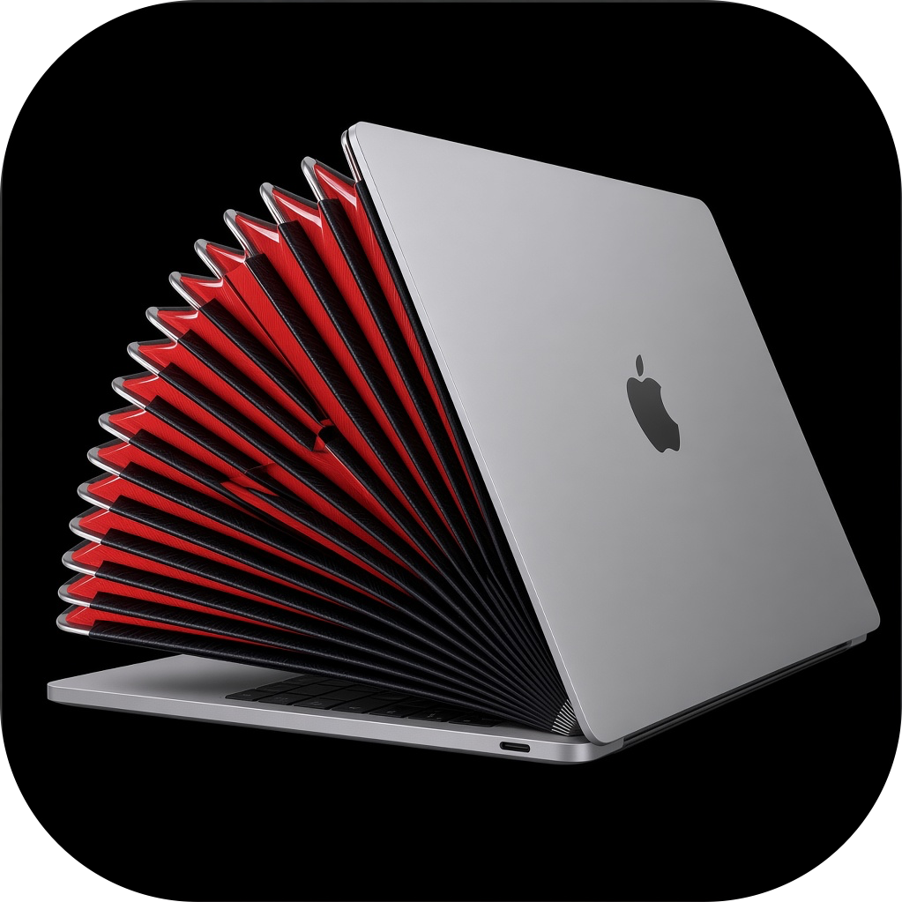
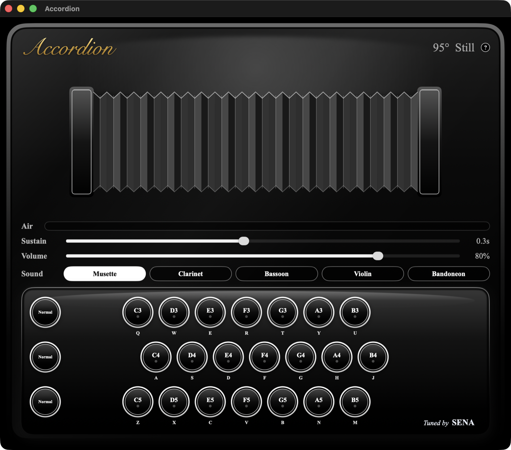

# Accordion

  

  Play the keyboard. Move the MacBook lid like accordion bellows.

  

Sound plays only while the lid is moving. Opening the lid pulls a rounder tone. Closing it pushes a brighter one.

Download [Accordion 1.0.0](https://github.com/MyoThetNaung/macaccrodion/releases/tag/v1.0.0) for Apple silicon, macOS 14 or later.

Tuned by SENA.
